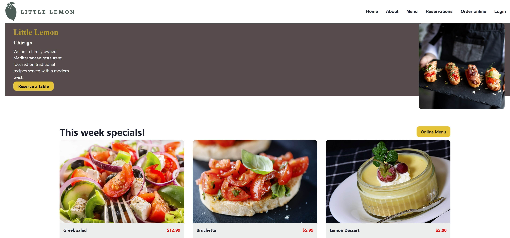
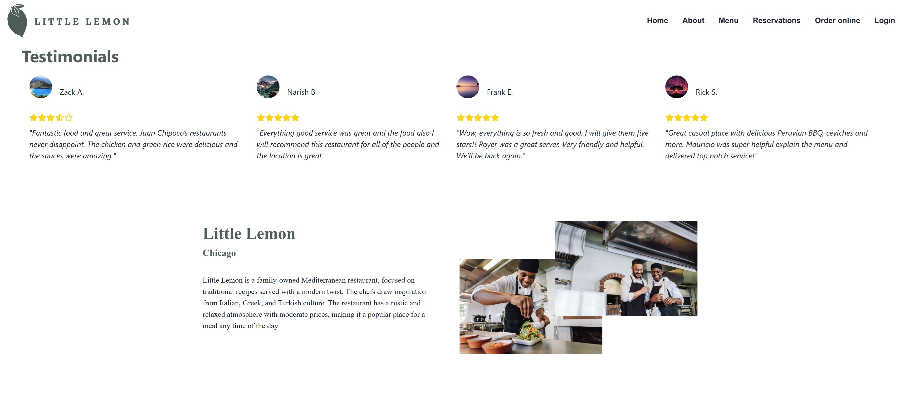
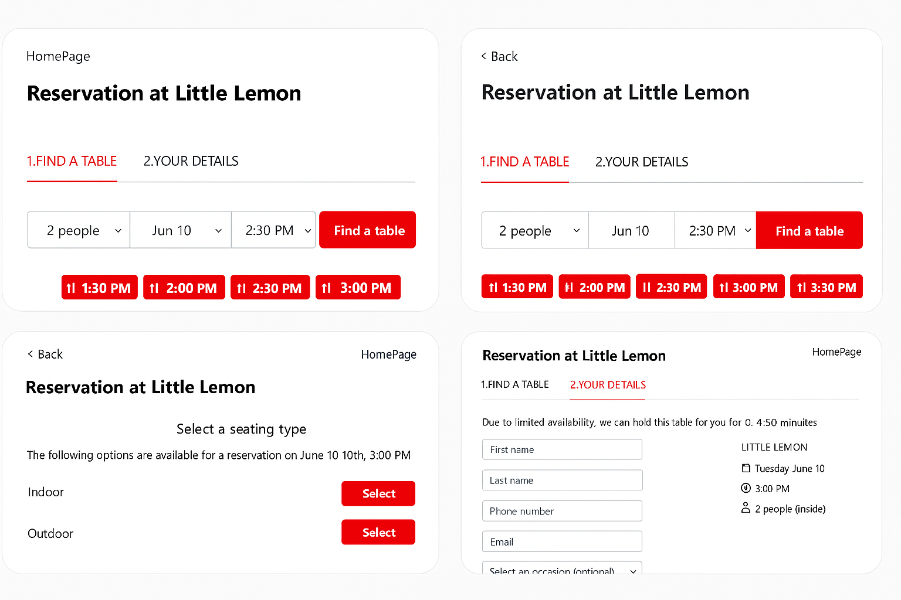

# Little Lemon Restaurant

A full-stack restaurant reservation experience built with React, Express, and MySQL.

**[Open the live frontend](https://little-lemmon-yeinier.netlify.app/)**



## Features

### Customer experience

- Responsive restaurant home page
- Weekly specials, menu highlights, and testimonials
- Reservation flow for date, time, party size, and seating location
- Nearby-time suggestions at 30- and 60-minute intervals
- Clear validation and availability feedback

### Reservation API

- Persistent tables and reservations in MySQL
- Capacity-aware table selection
- Overlap prevention using reservation time ranges
- Transactional selection of the smallest available table
- Server-side validation
- Administrative reservation listing by date and location

## Architecture

```text
React frontend → Express REST API → MySQL
```

The repository also includes Docker Compose services for the frontend, API, and database.

## Technology

- React 18
- Express 4
- MySQL
- Parameterized SQL queries
- Docker and Docker Compose
- CSS

## Local setup

### Frontend

```bash
git clone https://github.com/Yeinier22/Little-Lemon.git
cd Little-Lemon
npm install
npm start
```

### Backend

Create the database and run the scripts in `server/db`:

```sql
CREATE DATABASE little_lemon;
USE little_lemon;
```

Copy `server/.env.example` to `server/.env`:

```env
DB_HOST=localhost
DB_USER=your_user
DB_PASSWORD=your_password
DB_NAME=little_lemon
DB_PORT=3306
PORT=5001
```

Install and start the API:

```bash
cd server
npm install
npm run dev
```

The API runs at `http://localhost:5001/api`.

## Main API endpoints

```text
GET  /api/health
GET  /api/availability
GET  /api/availability/suggestions
POST /api/reservations
```

## Reservation rules

- Names must contain 2–100 valid characters.
- Party size must be between 1 and 20.
- Dates must be within the configured booking window.
- Time slots use 30-minute intervals.
- Seating location is `inside` or `outside`.
- Reservation duration is configurable.
- A table cannot be assigned to overlapping reservations.

## Docker

```bash
docker compose up --build
```

Services:

- Frontend: `http://localhost:3000`
- API: `http://localhost:5001/api`
- MySQL: `localhost:3307`

## Screenshots

### Testimonials



### Reservation experience



## Project background

The interface began as the Meta Front-End Developer Capstone project and was extended with a persistent Express and MySQL reservation system.
